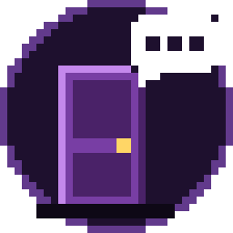
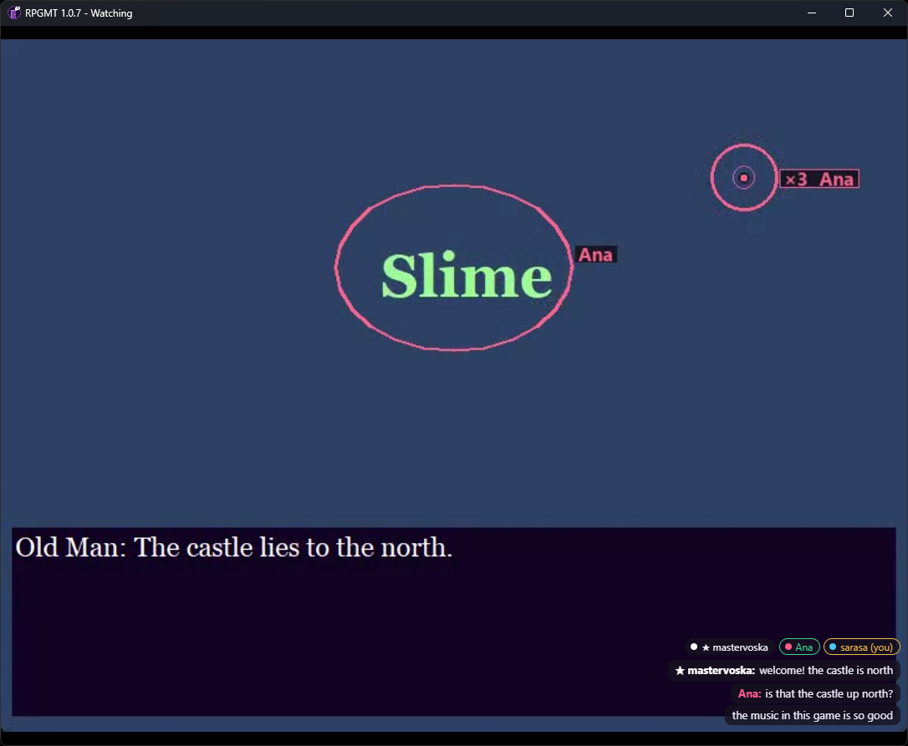
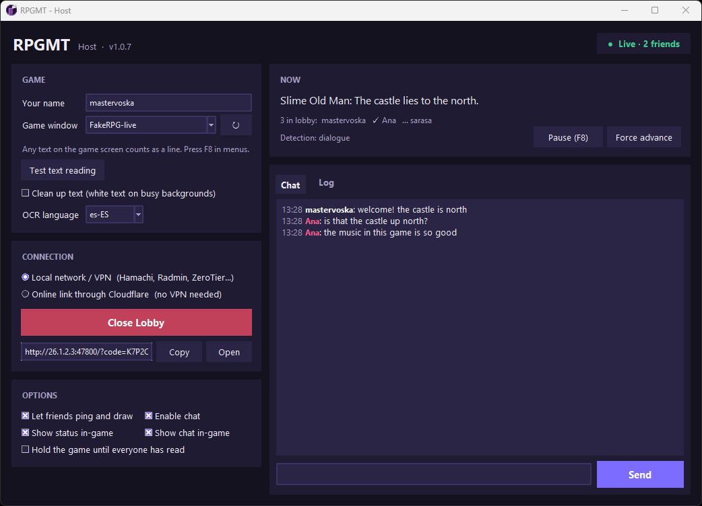
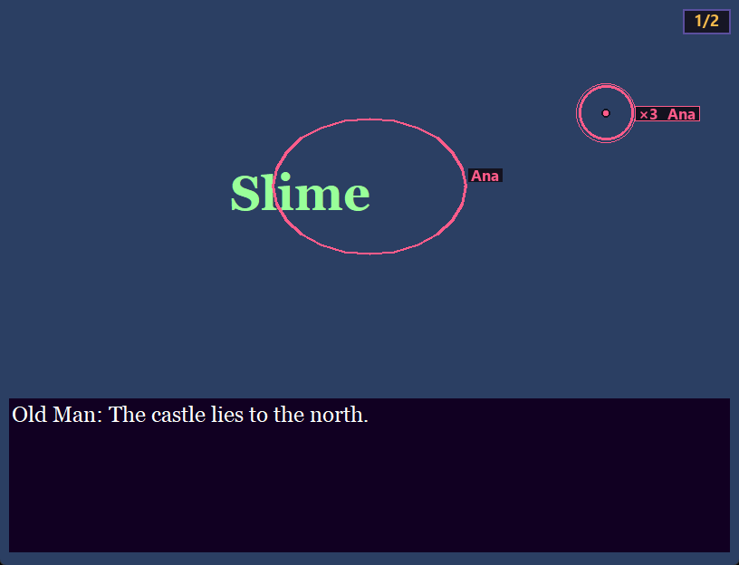

<p align="center">
  
</p>

<h1 align="center">RPGMT</h1>

<p align="center">
  <b>Play RPG Maker games together.</b><br>
  One person plays; friends watch live with sound, ping, draw and chat, and follow the story line by line.
</p>

<p align="center">
  <a href="https://github.com/xmelqui/RPGM-TOGETHER/releases/latest"></a>
  <a href="https://github.com/xmelqui/RPGM-TOGETHER/releases"></a>
  
  <a href="LICENSE"></a>
</p>

<p align="center">
  
</p>

## What it does

- **Watch together:** friends see the host's game live, with **only the game's sound**: no Discord voices, no music player.
- **React on the screen:** **click** to ping a spot on the host's game, **drag** to draw on it. Everyone sees it.
- **Chat** that floats over the game and fades away when nobody's talking.
- **Nobody gets left behind:** friends press **Space / Z** when they've read a line, and a small badge on the host's screen shows how many have (`1/2` → `✓ 2/2`). The host can even **hold the game until everyone has read**.
- **Any RPG Maker game:** 2000, 2003, XP, VX, VX Ace, MV, MZ. Nothing is installed into the game: RPGMT reads the dialogue from the screen with Windows' built-in text recognition.
- **No server needed:** play over Hamachi, Radmin VPN, ZeroTier, Tailscale or your home network, or share a free Cloudflare link.

<p align="center">
  
  
</p>

## Download

Grab **`RPGMT-x.y.z.zip`** from the [latest release](https://github.com/xmelqui/RPGM-TOGETHER/releases/latest), unzip it anywhere, and run `RPGMT.exe`. No installation, no Python. Windows 10 (version 2004 or newer) or Windows 11.

> **First run:** Windows SmartScreen may say *"Windows protected your PC"* because the app isn't code-signed. Click **More info → Run anyway**.

## Hosting

1. Open `RPGMT.exe` → **Host**.
2. Start your game and pick its window under **Game window**.
3. Choose how friends connect:
   - **Local network / VPN** (default): Hamachi, Radmin VPN, ZeroTier, Tailscale, or the same home network. Video and sound go straight between your PCs.
   - **Online link through Cloudflare:** for friends without a VPN.
4. Click **Create Lobby** and send friends the link RPGMT shows, e.g. `http://26.1.2.3:47800/?code=K7P2QX`. It includes the lobby code.
5. Play normally. Any text on screen counts as a line, so **press F8 while in menus** (and again to resume).

The first time, **Windows Firewall** asks whether RPGMT may use the network. Allow it, and tick *Public* too if you use Hamachi or Radmin, or friends can't connect.

**Options:** let friends ping and draw · show the read-count badge over your game · enable chat · show chat over your game · hold the game until everyone has read (your confirm keys wait until everyone pressed Read, then RPGMT presses Enter for you).

## Joining

Open `RPGMT.exe` → **Join**, enter your name, paste the host's link, and click **Join**. (Anyone can also open the link in a browser.)

| Key | What it does |
| --- | --- |
| **Space / Z / Enter** | Mark the current line as read (your name turns green) |
| **Click** | Ping that spot on the host's screen |
| **Drag** | Draw on the host's screen (fades 3 s after you let go) |
| **T** | Chat: Enter sends, Esc closes |

The sound and chat toggles appear in the game's bottom-left corner when you move the mouse there.

## Privacy & security

- **Lobby code:** every lobby gets a random code; without it nobody can join, chat or watch. Ten wrong codes get an address blocked for 10 minutes.
- **No hidden joining:** other websites can't secretly connect to an open lobby.
- **Limits:** messages, pings, drawing and video requests are size- and rate-limited, connections are capped, and nobody can pose as the host.
- **Your PC:** friends can't send keys or files to your PC. The stream shows **only the game window**, nothing else on your screen. RPGMT only hooks the keyboard while *hold the game* is on.
- **Good to know:** like any direct connection (Discord, games), friends can see the IP address you connect with: your VPN address, or your public IP in online mode.
- **Anti-cheat games:** RPGMT is made for single-player games. Don't use it with games that have anti-cheat (CS2, Valorant, …).

## Troubleshooting

- **Run `RPGMT.exe --selftest`:** it checks text reading, video/audio, game capture, the viewer window and your network addresses, and opens a report.
- **Friends can't connect:** check the firewall prompt (allow *Public* for Hamachi/Radmin), that you're on the same VPN network, and that they used `http://` (not `https://`).
- **Lines aren't detected:** click **Test text reading** in the host window. For text in another language, add that language's *Optical character recognition* pack in Windows Settings → Time & language → Language. Try toggling **Clean up text**.
- **The host's game is in exclusive fullscreen:** the overlays can't show there. Use windowed or borderless mode.

## Building from source

```bash
run.bat
```

`run.bat` creates a virtual environment and starts RPGMT from source (Python 3.10+). To build `RPGMT.exe`:

```bash
.venv\Scripts\python build_exe.py
```

<details>
<summary>How it works / project layout</summary>

| File | Role |
| --- | --- |
| `rpgmt/launcher.py` | First screen (Host / Join) and command-line options (`--host`, `--join`, `--selftest`) |
| `rpgmt/app.py` | Host window and glue between the parts |
| `rpgmt/detector.py` | Reads the game screen with OCR and decides when a line is fully shown |
| `rpgmt/ocr.py` | Windows OCR with line positions |
| `rpgmt/wincap.py` | Captures only the game window (Windows Graphics Capture) |
| `rpgmt/audio.py` | Captures only the game process's sound |
| `rpgmt/stream.py` | Live video + sound to each friend (WebRTC) |
| `rpgmt/lobby.py` | Lobby, web server, security limits |
| `rpgmt/overlay.py` | Status bubble, pings, drawings and chat over the host's game |
| `rpgmt/gate.py` | Holds the host's confirm keys in "hold the game" mode |
| `rpgmt/viewer.py`, `rpgmt/web/index.html` | The friend's viewer |
| `rpgmt/tunnel.py` | Optional Cloudflare link (signature-checked `cloudflared`) |
| `tools/make_icon.py` | Draws the pixel-art icon |

</details>

## License

[MIT](LICENSE) © 2026 xmelqui
